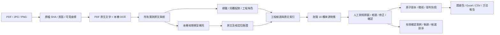

# DrawIQ 0.8.0 擷取與耐落標籤準確度盤點

盤點日期：2026-10-07。對象：`DrawIQ_Workbench` 的應用程式、實際使用的舊版解析器介面、本機 OCR 介面、覆核與匯出鏈路。本報告將程式可重現的缺陷、工程角色缺口與模型能力限制分開記錄。它不是對所有第三方套件逐行安全審查，也不是全部圖面已有人工金標的宣告。

主要問題在於「讀到了文字」到「確認文字用途」之間缺少一致的工程角色與空間證據。舊版的保守欄位驗證擋下部分誤填，但也會漏掉確實存在的塗膠產品、RFQ 發出公司、橫向標籤值及有條件的試驗要求。單純調高分數或增加拒絕規則不能解決這個問題。

## 實際資料流

`ui.MainWindow` 啟動匯入、整頁分析、ROI 重讀或人工覆核。`ingest.prepare_document()` 保存原件、180 DPI 可見頁面、PDF 文字位置與座標系。`bounded.analyze()` 為每頁與每個選定模型啟動隔離程序；`page_worker` 配置固定 OCR 後呼叫 `extraction.analyze()`。結果先 checkpoint 原文，再做報價／表格／工程分析及可選 VLM；`apply_analysis()` 經 `Store.mutate()` 合併到版本化文件。

左側來源是需求與 `drawing_observation` 索引的共同投影；中央框是 `regions`，使用原頁左上角正規化座標；右側 `quotation_rows()` 只引用候選來源 ID，不自行複製另一套事實。人工來源對應保存在 `quotation_mapping`。因此修正候選後，左右兩側與匯出應共用同一值與證據。

## 全部應用模組的職責

表中涵蓋本次盤點時的 `workbench/*.py`。對準確度直接有影響的模組另作函式級分析；其他模組檢查入口、資料流與依賴，避免把商務草稿、搜尋模型或幾何工具誤當文字辨識。

| 邊界 | 模組 | 應負責的事實與限制 |
|---|---|---|
| 入口與三欄介面 | `ui.py`, `workspace_shell.py`, `workflow_ui.py` | 原件匯入、工作執行、候選／原圖／標籤同步、其他業務頁面 |
| 候選覆核 | `review_workspace.py`, `review_queue.py`, `review_ui.py`, `quotation_workspace.py`, `engineering_workspace.py` | 顯示、搜尋、定位、人工指定來源、確認及方法查詢；分組不等於刪除或確認 |
| 中央原圖與框選 | `canvas.py`, `region_capture_ui.py` | 選擇、畫框、移動、旋轉、軌跡與裁圖預覽 |
| 工作階段 | `session_files.py`, `session_ui.py` | 結果清單／操作手冊；書籤不覆寫工程事實 |
| 匯入與來源 | `ingest.py`, `paths.py` | SHA、原件、頁面、PDF 字詞、位圖位置、搬遷路徑與舊成果匯入 |
| 讀圖執行 | `bounded.py`, `page_worker.py`, `extraction.py`, `ocr_runtime.py`, `engineering_ocr.py` | 固定 OCR／本機模型、預算、取消、checkpoint、工程區塊重讀、坐標回原圖、原始回應與合併 |
| 表單／表格／欄位 | `quotation.py`, `quotation_ocr.py`, `form_extraction.py`, `extraction_quality.py` | 明示標籤、同列／同欄值、二次 OCR、格線與誤命中檢查；不猜未知表格欄名 |
| 工程語意 | `engineering.py`, `engineering_semantics.py`, `knowledge.py` | 全原文候選、符號索引、角色、工程分類、條件與摘要 |
| 標籤決策 | `quotation_layout.py`, `quotation_validation.py` | 16 欄語意、原文支持、單位、衝突及拒絕原因；分數不能替代用途證據 |
| 資料與保存 | `domain.py`, `store.py`, `profiles.py`, `backup.py` | 結構、條件、依賴、確認、原子版本、追加稽核、發布與客製必要欄位 |
| 人工回饋 | `feedback.py`, `learning.py` | 有效確認、追加軌跡、上下文候選排序、經保留案例測試的修正建議 |
| 查詢與知識圖 | `entity_graph.py`, `graph_view.py`, `retrieval.py`, `corpus.py` | 有來源的關係、神經嵌入搜尋及語料匯出；檢索相似度不是辨識正確率 |
| 方法與驗證 | `methods.py`, `harness.py`, `harness_contracts.py`, `harness_validation.py` | 實際執行方法、工程契約、架構檢查、案例及過期報告判定 |
| 證據輸出 | `exporting.py` | 候選、標籤、原框、方法、原始回應、人工框選及稽核；官方發布快照保持不變 |
| 商務草稿 | `business.py`, `specification.py`, `specification_ui.py`, `specification_export.py` | 詢價、成本試算、工序、規格確認單；原圖沒有的單號、價格或日期需由承辦人提供 |
| 幾何工具 | `geometry.py`, `geometry_worker.py` | STEP 幾何量測；不能把外形估測尺寸當圖面文字 |
| 帳號與整合 | `auth.py`, `auth_ui.py`, `api.py` | 本機工作區帳號與選用的已發布知識唯讀 API |
| 套件版本 | `__init__.py` | 產品版本；演算法版本與實際模型另由方法紀錄列示 |

使用中的 OCR 模型為 `RapidOCR 3.9.2 / PP-OCRv6-small / ONNX CPU`，偵測、辨識及方向權重由 `ocr_runtime.configure()` 固定。解析器仍透過 `vendor/legacy/drawing_intelligence`（存在時）或舊 `DrawIQ_v0.2.0` 目錄使用。這個介面必須納入回歸，不能只看新工作臺模組。

Ollama 模型補充圖面語意；不同名稱的模型不代表不同結果已校準。ShapeLab 清除／相似工具及 `retrieval.py` 嵌入搜尋用途不同，沒有參與耐落報價欄位 OCR，也不能把它們的權重數量當成報價準確度。

## 缺陷與修正方向

下列「舊行為」以 0.7.0 程式和既有實測成果為基準；新版本的完成與通過狀態，以版本驗證與準確度評估報告為準。

| 優先 | 真正原因／位置 | 舊行為與影響 | 應有的修正 |
|---|---|---|---|
| P0 | `ocr_runtime.configure()`／舊 `_text_is_usable()` | 只要原生 PDF 文字超過 60 字且可讀，就整頁只用 PDF 字層。混合 PDF 的可讀頁尾會壓掉掃描主體，沒有 OCR 機會。 | 由 `ingest` 讀真正位圖位置。純文字／向量頁保留快路；有位圖或舊資料覆蓋未知時融合原生文字與 OCR；不同位置或不同值不抹除。 |
| P0 | `extraction.analyze()` VLM 證據建立；`quotation_layout.source_issue()` | schema 合法框會生成以模型原文為內容的證據；若沒有對齊實測 OCR，模型自己的「數量：160」也可能通過值支持檢查。這是循環支持。 | 自動帶入需獨立 PDF／OCR 支持與位置；模型新增漏讀先保留為待定位／待覆核候選，必要時 ROI 重讀；合法座標不等於框內文字正確。 |
| P1 | `quotation.grouped_lines()`／`extract_quotation()` | 同基線拼接整頁片段，可能跨相距很遠的欄；沒有冒號或標籤與值分行時容易漏值。 | 明確空間欄、同列與相鄰欄值範圍；保留每一原框，不製造跨欄聯句；缺值與無法辨識分開。 |
| P1 | `form_extraction.extract_form_fields()` | 只支援特定表頭且至少兩個同行標題，不能覆蓋一般左右標籤表單；表頭下方窗口很窄。 | 擴充有可證明邊界的橫向、直向配對與單位／標題排除；表格變體或跨列仍須人工。 |
| P1 | `engineering.catalogue_candidates()`／舊 `context_heading()` | `Material: Nylon ... Tuflok` 在螺紋防鬆區的候選可以被擋為基材，但沒有另建指定膠產品。因此「不要錯填 Nylon」同時造成「Tuflok 不帶入」。 | 分開基材、塗膠材料、指定品牌／產品；產品原字串與 threadlock 區塊證據同時保留。不能從 Nylon 推斷任意牌號。 |
| P1 | `quotation_validation.value_issue()` customer 角色 | 責任聲明及客戶料號被擋是必要的，但檢查僅容許 Customer／客戶字面標籤，RFQ 發出公司只成為未分類原文。 | 區分發出公司、收件供應商、設計責任公司、料號與真正客戶；工作區採用耐落立場時仍需完整 RFQ 與收件人證據，不能直接把所有 TO 當客戶。 |
| P1 | VLM 提示 generic `torque`；`domain.checks()` | 鎖緊、旋入、破壞、旋出和有／無負載共用 key／空條件。多個有效試驗值被視為相互矛盾；「20.7Nm以上」也不能直接 Decimal。 | 由實測原文建立扭力角色＋負載條件；值、原印單位與比较運算分欄；不同試驗不得平均或互相替代。條件不明保持明示待核對。 |
| P1 | `quotation_layout.automatic_source()` | 任何同欄未決候選均能壓住已支持來源；同值候選的 subject／conditions 差異阻止帶入。不能分辨同值多方法與真正不同零件／範圍。 | 以工程角色、實際來源與有效範圍分組；同義、同值與同一印字去重；多種真正有效值維持人工選擇，無效候選不能無條件否決有效來源。 |
| P1 | `ingest.locate_evidence()` | 值／文字包含查詢回傳最多 12 個全頁匹配，重複尺寸、標準或數字可能連到多個遠處位置。 | 優先完整原文與唯一實測匹配；位置／用途無法判定時明確標示歧義，不靠第一個數值命中定位。 |
| P2 | `extraction.models()`＋模型選單 | `/api/tags` 安裝列表未必包含 capabilities，UI 卻直接以 capabilities 含 vision 篩選，可能把已安裝視覺模型藏掉。 | 查實際 `/api/show` 能力與失敗狀態；不猜檔名是否可看圖，不把安裝等同本次有成功使用。 |
| P2 | `feedback.examples()` | 已確認與 `support_verified` 是必要條件，但只做粗值型別檢查；用途不支持的人工例外仍可能進入排序樣本。 | 樣本附來源角色與排除／隔離理由；有效人類例外可保存歷程，但不能當自動填值的證據規則。學習型態與評估結果單獨列示。 |
| P2 | Harness 固定文本案例 | 16 個合成契約能證明型別／拒絕規則；不會執行真 OCR，也不量化有效欄位漏填。 | 同時評估真正固定 OCR 成果的語意映射、重跑原件的端到端結果與正例／反例；精確填入率和漏填需分開。 |

## 0.8.0 實作狀態

上述缺陷對應的本版程式調整已完成；整體測試與原件比較的通過狀態以各自報告為準。

| 已實作 | 最終程式位置與行為 |
|---|---|
| 混合 PDF 字層與掃描內容 | `ingest._page_raster_boxes()`／`pdf_raster_boxes()` 保存或補讀實際位圖位置。`ocr_runtime.recognize_page()` 融合量測字框，`extraction.analyze()` 傳入覆蓋資訊、保留方法與部分失敗狀態。 |
| 同列／同欄標籤配對 | `form_extraction.extract_form_fields()` 支援明確報價標籤、分段標籤與相鄰值；`extraction.analyze()` 在工程頁與報價頁共用空間配對。`quotation_ocr.combine_candidates()` 比較值及單位，保留不同幣別／分母衝突。 |
| 工程文字區塊重讀 | 新 `engineering_ocr.py` 對最多 8 個已偵測工程區塊作受預算限制的二次讀取，保存原讀值、實際新框及方法。未讀清標準號不猜測替換。 |
| 指定膠產品與完整螺紋 | 新 `engineering_semantics.semantic_requirements()` 建立印出的 Tuflok 等防鬆產品角色及完整螺紋；`engineering.catalogue_candidates()` 納入候選。它不把 Nylon 當零件基材，也不補推螺栓長度。 |
| 有／無負載與試驗扭力 | `engineering_semantics` 分開 loaded／unloaded 與 tightening／installation／breakaway／removal。表頭與條件同時作繁簡語意匹配，證據原字串保持不變；實際 `沒有負载：` 也不會錯套上方 `有負載：`。`normalize_model_torque()` 從量測來源重解析模型值與條件。 |
| 品質文件條件保留 | `engineering.quality_component_value()` 與 `refresh_composites()` 彙整時保留「首批需附／每批需附」條件，避免把不同批次義務變成無條件文件清單。 |
| RFQ 發出方建議 | `engineering_semantics` 要求圖頭公司、詢價單與耐落收件人三處證據且沒有競爭公司。`quotation_layout.source_issue()` 驗證該角色；右側 tooltip 明示「客戶角色推定」，供人確認交易關係。此推定另列，不納入字面欄位自動精確率／召回率。 |
| 模型證據獨立支持 | `quotation_layout.source_issue()` 會拒絕尚未有同位置量測讀文支持的模型來源；模型自己生成的證據不再替自己證明。已有明確人工原圖確認仍保留其責任與歷程。 |
| 重複文字定位 | `ingest.locate_evidence()` 優先完整原文與較強匹配；同等強度的多處命中回傳未定位，避免把全頁最多 12 個遠處框合為一個對象。 |
| 同值比較與保留原字 | `quotation_layout.equivalent_value()` 處理等值日期、數字及螺紋小數記法的比較，不改寫保存的人類值；未知單位、不同有效值與未決來源仍要求人工選擇。 |
| 模型查詢與有效學習樣本 | `extraction.models()` 補查 `/api/show` 能力與失敗紀錄。`feedback.examples()` 增加 `source_issue()` 檢查，來源用途未支持的人工例外不會進入候選排序的正確樣本。 |

`quotation_layout.automatic_source()` 對仍存在未決／衝突的欄位繼續保守處理，沒有以最高分強行選值。跨零件、跨範圍表格、多個可用客戶或多個不同規格仍需人工指定，這部分未宣稱已完成任意工程圖的角色辨別。

## 具體工程角色

- `第一張實際工程圖` 的原文在防鬆規範上下文內列出尼龍及防鬆產品。Nylon 是此處塗膠材料候選；Tuflok 是印出的產品 token；兩者都不能自動宣稱為螺絲基材。文字拼寫錯誤保留原文，工程候選另保存其角色。
- `Customer 456289 is design responsible.` 是責任／客戶代碼敘述。它不提供公司名稱。右側客戶欄不能填整段或任意擷取 `456289` 作名稱。
- `第二張實際工程圖` 原文公司抬頭、委外加工詢價單及此致耐落收件人有不同角色。RFQ 日期不等於耐落報價日期；經辦人不必然是耐落報價人員；外包件號不必然是報價單號。
- 有負載的鎖緊 `23 Nm`、破壞 `≥20.7 Nm`、旋出 `≤26 Nm`，與無負載旋入 `≤1.5 Nm`、破壞 `≥4 Nm`、旋出 `≤26 Nm`，應是不同條件／用途候選。有效測試值不應彼此判為矛盾。
- 年度 `7.2 萬 PCS / 年` 是年度需求；即使數值可讀，也不等於本次報價數量。
- 黑色封孔／鍍層顏色與塗膠顏色不能共用角色。強度等級、螺紋公差及材料牌號也需分開。
- 單獨 `M8X1.25-6h` 可作圖上螺紋規格，不應補成未知長度的 `M8 × 1.25 × 50`。有完整印出的零件標題時才引用完整規格。

## 已有保護應維持

`Store.mutate()` 保存單一原子版本與稽核；每次人工修改都讓相關確認與依賴失效。重解析保護人工值、已驗證資料、排除、人工框與依賴。`quotation_mapping` 的明確人工選擇優先於自動對應。核准／發布沿用一致的工程硬檢查與不可變發布快照。

`region_capture` 保存原始裁圖、输入圖、SHA、OCR 結果、人工改字與欄位採用；`canvas` 另存選框／移動／調整軌跡。確認动作是人類對值、單位、對象、條件與原圖的覆核，不應因模型有輸出或分數高而自動替人確認。

## 驗證分層與實測證據

1. 函式與契約回歸：角色、型別、同列／同欄、不同負載、重複來源、排除與人工值保護。這類案例可用合成資料明確重現錯誤。
2. 固定原圖＋固定 OCR 重播：在相同擷取結果上比較舊／新欄位決策，分辨是字讀錯還是用途判錯。原件 SHA 與原框應固定。
3. 端到端重跑：固定 OCR backend、處理相同 PDF／JPG、計時與實際方法；不能把切換了模型／字體／預處理的兩次結果宣稱單一映射修正的提升。
4. 人工標註擴充：依來源 SHA 分組訓練與保留組。相同原件 PDF 與 JPG 衍生版不是兩個獨立新来源。

本次新增 `tests/test_hybrid_pdf_ocr.py`，檢查原生頁尾不壓過扫描主體、實測純向量頁快路、舊資料覆蓋未知、短原生標註保存、相同框方法融合、遠處重複字與不同讀值保留、OCR 失敗後的部分覆盖狀態，以及 PDF 旋轉後位圖座標。12 個新增檢查與 7 個既有 domain 檢查已通過。

另以固定真 OCR 執行 `qa/hybrid_pdf_smoke_0_8.py`。合成混合 PDF 同時有可用原生頁尾及位圖工程內容；舊 native-only 路徑漏掉 5 個已印出的目標 token，新的固定 PP-OCRv6 路徑取得 `S45C`、`precote 80`、`160 PCS`、`12.50 TWD`、`M8 x 1.25 x 50` 共 5/5；實測框從 17 增為 25。詳細記錄：hybrid PDF smoke（原始驗證工作區：`qa/hybrid_pdf_0.8.0/report.json`）。這只證明混合 PDF 讀圖路徑已修正，不能外推為所有圖面的辨識率。

版本完整測試與圖面映射評估報告應另行列示錯填、可自動帶入的漏填、保留待判定、定位證據與來源未標示欄位。原圖不存在的報價單號、有效日期、數量或價格，不應為了提高「填欄率」而推算。

本版原件評估：固定來源與標註（原始驗證工作區：`evaluation/quotation_accuracy_sources.json`）、前後比較報告（原始驗證工作區：`qa/quotation_accuracy_0.8.0/comparison.json`）。來源包含使用者的 16 欄合成示範與兩張選定工程圖；報告分開列示工程圖與示範，只有 `valid_current_comparison=true` 才代表目前程式、固定權重與標註仍符合該比較。JPG 是工程 PDF 可見頁面的品質 95 轉換，沒有把它當低品質手機照片的驗證。

介面檢查：隔離 UI smoke（原始驗證工作區：`qa/accuracy_ui_0.8.0/report.json`）、重跑腳本 `qa/verify_accuracy_ui_0_8.py`。它從保存的辨識快照建立臨時資料庫，檢查 1920×1080 與 1280×800 的候選可用性、16 欄、來源導航、方法版本、Tuflok／基材分離及 RFQ 角色提示；並用真 RFQ 原文檢查有／無負載扭力不互相衝突。它不呼叫正式資料庫，也不替使用者執行人工確認。

## 仍需持續建置的能力

2026-10-08 啟動盤點補充：`app.py` 為 GUI／CLI 分流入口，`run.bat` 檢查 runtime 與依賴，`startup.py` 記錄無憑證的啟動階段並整理 Windows Qt 環境，`auth_ui.DesktopSession` 保留登入生命週期並顯示初始化錯誤。入口與批次檔均納入 Harness 指紋，新增 modal／批次回歸及原生 Windows 啟動實測；詳見 [啟動修正](startup_fix_0.8.0.md)。先前 OCR 比較仍是當次固定指紋的結果，本次未重跑圖面辨識評估。

全圖 OCR 已完成只是执行狀態。細小符號、手寫字、旋轉標註、GD&T 框、低品質照片、跨頁表格變體及標準之間的工程關係，仍須更大的人工標註資料與分類型評估。當前 VLM 的每次最多 8 筆補充不代表全圖語意已经完整。

人工學習現階段是有效確認案例的上下文排序與受控修正建議。框選軌跡與新案例可以匯出；本版沒有自動訓練 OCR 或 VLM 神经權重。候选排序、規则重播與真正神经模型訓練必须保持分別可查。
